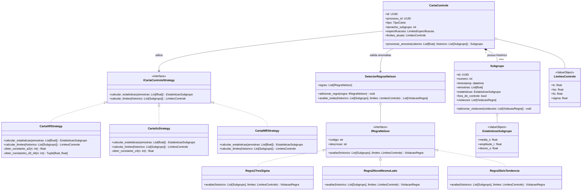
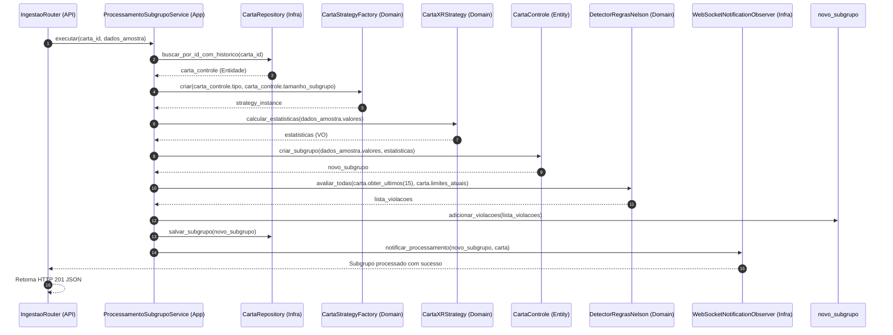

# Arquitetura do Backend - Sistema de Controle Estatístico de Processos (CEP)
## Modelagem e Arquitetura Orientada a Objetos (OOP)

---

## 1. Visão Geral e Filosofia Arquitetural

A arquitetura do backend foi concebida sob os princípios da **Arquitetura Limpa (Clean Architecture / Ports & Adapters)**, com forte adesão ao **Paradigma da Orientação a Objetos (OOP)** e aos princípios **SOLID**. 

Em vez de tratar o backend como um mero conjunto de funções procedurais ou *scripts* dispersos sobre modelos anêmicos de banco de dados, o núcleo da aplicação encapsula a lógica estatística e as regras de negócio em um **Modelo de Domínio Rico**, onde classes expressam comportamentos, garantem invariantes de estado e utilizam polimorfismo para flexibilidade e manutenibilidade.

```text
┌────────────────────────────────────────────────────────────────────────────┐
│ CAMADA DE APRESENTAÇÃO / API (FastAPI)                                     │
│  - Routers HTTP & WebSocket Endpoints                                      │
│  - DTOs / Schemas de Entrada e Saída (Pydantic v2)                         │
└─────────────────────────────────────┬──────────────────────────────────────┘
                                      │ Invoca
┌─────────────────────────────────────▼──────────────────────────────────────┐
│ CAMADA DE APLICAÇÃO (Use Cases / Application Services)                     │
│  - Orquestra o fluxo de dados entre Domínio e Infraestrutura              │
│  - ProcessarSubgrupoService, ConfigurarCartaService, AuthService           │
└───────────────────┬─────────────────────────────────────┬──────────────────┘
                    │ Utiliza                             │ Implementa
┌───────────────────▼─────────────────────┐  ┌────────────▼──────────────────┐
│ CAMADA DE DOMÍNIO (Núcleo Puro)         │  │ CAMADA DE INFRAESTRUTURA      │
│  - Entidades Ricas (Carta, Subgrupo)   │  │  - Repositórios (SQLAlchemy)  │
│  - Objetos de Valor (Limites, VOs)      │  │  - WebSocket ConnectionManager│
│  - Interfaces / Contratos (ABCs)        │  │  - Adaptadores Externos       │
│  - Design Patterns (Strategy, Nelson)   │  │  - MySQL 8.0 Driver (asyncmy) │
└─────────────────────────────────────────┘  └───────────────────────────────┘
```

---

## 2. Princípios SOLID Aplicados ao Domínio CEP

* **S - Single Responsibility Principle (SRP):** Cada classe possui uma responsabilidade única e bem delimitada. O cálculo matemático de limites não reside na entidade de persistência, e a validação de regras de anomalia é isolada em classes especialistas.
* **O - Open/Closed Principle (OCP):** O sistema é aberto para extensão e fechado para modificação. Novos tipos de cartas de controle (ex: CUSUM, EWMA) ou novas regras de detecção de anomalias (ex: Western Electric, regras customizadas) são adicionados criando novas classes derivadas de contratos abstratos, sem alterar o código existente.
* **L - Liskov Substitution Principle (LSP):** Qualquer estratégia concreta de carta de controle (como `CartaXRStrategy` ou `CartaXsStrategy`) substitui perfeitamente a classe base abstrata `ICartaControleStrategy` sem quebrar o comportamento esperado pelo motor orquestrador.
* **I - Interface Segregation Principle (ISP):** Interfaces e classes abstratas são coesas e específicas. Em vez de uma interface monolítica genérica, definem-se contratos enxutos (ex: `ICalculadorLimites`, `IEvaliadorRegraNelson`, `ISubgrupoPublisher`).
* **D - Dependency Inversion Principle (DIP):** Os serviços de alto nível (casos de uso) dependem de abstrações (interfaces/ABCs), e não de implementações concretas (como detalhes de SQLAlchemy ou FastAPI). A injeção de dependências do FastAPI é utilizada para prover as implementações em tempo de execução.

---

## 3. Padrões de Projeto (Design Patterns) Adotados

### 3.1. Strategy Pattern (Estratégias de Cálculo de Cartas)
Diferentes cartas de controle possuem formulações matemáticas, coeficientes normalizados ($A_2, D_3, D_4, c_4$) e métricas de dispersão distintas:
* **Interface Abstrata:** `ICartaControleStrategy`
* **Implementações Concretas:**
  * `CartaXRStrategy`: Subgrupos pequenos ($n \le 10$), baseada em média e amplitude.
  * `CartaXsStrategy`: Subgrupos maiores ($n > 10$), baseada em média e desvio padrão.
  * `CartaIMRStrategy`: Leituras individuais unitárias ($n = 1$) com amplitude móvel.
  * `CartaAtributosPStrategy`: Proporção de itens defeituosos (distribuição binomial).

### 3.2. Factory Pattern (Instanciação de Estratégias)
A classe `CartaStrategyFactory` encapsula a decisão de criação da estratégia apropriada a partir do tipo da carta (`tipo_carta`) e do tamanho amostral (`tamanho_subgrupo`), desacoplando a camada de aplicação dos detalhes de inicialização de cada cálculo.

### 3.3. Specification & Composite Pattern (Detecção das 8 Regras de Nelson)
A avaliação de estabilidade estatística é decomposta em regras individuais:
* **Interface Base:** `IRegraNelson` com método polimórfico `avaliar(historico, limites) -> Optional[ViolacaoRegra]`.
* **Regras Específicas:** `Regra1TresSigma`, `Regra2NoveLadoMedio`, `Regra3SeisTendencia`, `Regra4QuatorzeAlternados`, etc.
* **Compositor / Evaluator:** `DetectorRegrasNelson` agrega uma coleção de instâncias de `IRegraNelson`, executa-as em lote e consolida a lista de anomalias encontradas.

### 3.4. Repository Pattern (Isolamento de Persistência)
Abstrai o acesso a dados para manter a camada de domínio livre de acoplamento ao ORM ou dialeto SQL:
* Interfaces: `ICartaControleRepository`, `ISubgrupoRepository`, `IUsuarioRepository`.
* Implementações: `MySQLCartaControleRepository`, `MySQLSubgrupoRepository` utilizando SQLAlchemy 2.0 assíncrono.

### 3.5. Observer / Publisher-Subscriber Pattern (Tempo Real Reativo)
Após o processamento e cálculo do novo subgrupo, os interessados devem ser notificados sem gerar acoplamento rígido:
* `ISubgrupoObserver`: Interface com método `notificar_processamento(evento: SubgrupoProcessadoEvent)`.
* `WebSocketNotificationObserver`: Implementação concreta que delega ao `ConnectionManager` o broadcast via WebSocket para os navegadores conectados.

---

## 4. Diagrama de Classes do Domínio (UML)



---

## 5. Modelagem de Domínio: Entidades vs. Value Objects

### 5.1. Value Objects (Objetos de Valor Imutáveis)
Objetos sem identidade própria definidos puramente por seus atributos, implementados via `@dataclass(frozen=True)`:

* **`LimitesControle`**: Encapsula $LC$, $LSC$, $LIC$ e $\sigma$. Garante a invariante $LIC \le LC \le LSC$ no momento da sua construção.
* **`LimitesEspecificacao`**: Encapsula $LSE$, $LIE$ e valor nominal.
* **`EstatisticasSubgrupo`**: Agrupa $\bar{X}, R, s$.
* **`IndicesCapacidade`**: Agrupa $C_p, C_{pk}, C_{pm}$, contendo métodos para avaliar se o processo é considerado "capaz" ($C_{pk} \ge 1.33$).
* **`ViolacaoRegra`**: Representa a violação de uma regra de Nelson com o código, descrição e índice do subgrupo.

### 5.2. Entidades Ricas com Comportamento
Ao invés de manipuladores estáticos de dados, as entidades gerenciam seu próprio ciclo de vida e consistência:

* **`CartaControle`**: 
  * Valida se a quantidade de medições recebidas coincide com o `tamanho_subgrupo`.
  * Determina quando os limites de controle devem ser recalculados.
  * Mantém histórico ordenado cronologicamente de seus subgrupos.
* **`Subgrupo`**:
  * Guarda as medições brutas e os valores derivados.
  * Encapsula a regra de se classificar como `fora_de_controle = True` caso haja violações registradas.

---

## 6. Diagrama de Sequência Orientado a Objetos (Processamento de Amostra)

O diagrama abaixo ilustra a colaboração entre os objetos quando um novo subgrupo chega à API:



---

## 7. Implementação de Referência das Classes Principais (Python 3.12+)

Abaixo estão os modelos conceituais estruturados em Python que guiam o desenvolvimento em `backend/app/cep`:

### 7.1. Objetos de Valor (Value Objects)

```python
from dataclasses import dataclass
from typing import Optional

@dataclass(frozen=True)
class LimitesControle:
    lc: float
    lsc: float
    lic: float
    sigma_estimado: float

    def __post_init__(self):
        if not (self.lic <= self.lc <= self.lsc):
            raise ValueError(f"Invariante violada: LIC ({self.lic}) <= LC ({self.lc}) <= LSC ({self.lsc})")

@dataclass(frozen=True)
class EstatisticasSubgrupo:
    media_x: float
    amplitude_r: float
    desvio_s: float

@dataclass(frozen=True)
class ViolacaoRegra:
    codigo_regra: str
    descricao: str
    numero_subgrupo: int
```

### 7.2. Strategy: Contrato e Estratégia Concreta ($\bar{X}-R$)

```python
from abc import ABC, abstractmethod
import numpy as np

class ICartaControleStrategy(ABC):
    @abstractmethod
    def calcular_estatisticas(self, amostras: list[float]) -> EstatisticasSubgrupo:
        """Calcula métricas de posição e dispersão para a amostra recebida."""
        pass

    @abstractmethod
    def calcular_limites(self, medias: list[float], dispersoes: list[float], n: int) -> LimitesControle:
        """Calcula os limites estatísticos (LSC, LC, LIC) a partir do histórico."""
        pass

class CartaXRStrategy(ICartaControleStrategy):
    # Tabela de constantes para n=2 até 10
    A2_TABLE = {2: 1.880, 3: 1.023, 4: 0.729, 5: 0.577, 6: 0.483, 7: 0.419, 8: 0.373, 9: 0.337, 10: 0.308}
    D3_TABLE = {2: 0.0, 3: 0.0, 4: 0.0, 5: 0.0, 6: 0.0, 7: 0.076, 8: 0.136, 9: 0.184, 10: 0.223}
    D4_TABLE = {2: 3.267, 3: 2.574, 4: 2.282, 5: 2.114, 6: 2.004, 7: 1.924, 8: 1.864, 9: 1.816, 10: 1.777}
    D2_TABLE = {2: 1.128, 3: 1.693, 4: 2.059, 5: 2.326, 6: 2.534, 7: 2.704, 8: 2.847, 9: 2.970, 10: 3.078}

    def calcular_estatisticas(self, amostras: list[float]) -> EstatisticasSubgrupo:
        arr = np.array(amostras, dtype=np.float64)
        media = float(np.mean(arr))
        amplitude = float(np.ptp(arr)) # Max - Min
        desvio = float(np.std(arr, ddof=1)) if len(arr) > 1 else 0.0
        return EstatisticasSubgrupo(media_x=media, amplitude_r=amplitude, desvio_s=desvio)

    def calcular_limites(self, medias: list[float], dispersoes: list[float], n: int) -> LimitesControle:
        x_dupla_barra = float(np.mean(medias))
        r_barra = float(np.mean(dispersoes))
        
        a2 = self.A2_TABLE.get(n, 0.577)
        d2 = self.D2_TABLE.get(n, 2.326)
        
        lsc = x_dupla_barra + (a2 * r_barra)
        lic = x_dupla_barra - (a2 * r_barra)
        sigma = r_barra / d2 if d2 > 0 else 0.0
        
        return LimitesControle(lc=x_dupla_barra, lsc=lsc, lic=lic, sigma_estimado=sigma)
```

### 7.3. Specification / Rules: Regras de Nelson

```python
class IRegraNelson(ABC):
    @property
    @abstractmethod
    def codigo(self) -> str:
        pass

    @property
    @abstractmethod
    def descricao(self) -> str:
        pass

    @abstractmethod
    def avaliar(self, ultimas_medias: list[float], limites: LimitesControle) -> Optional[ViolacaoRegra]:
        pass

class Regra1TresSigma(IRegraNelson):
    @property
    def codigo(self) -> str:
        return "REGRA_1"

    @property
    def descricao(self) -> str:
        return "Ponto fora dos limites de controle (além de 3 sigma)"

    def avaliar(self, ultimas_medias: list[float], limites: LimitesControle) -> Optional[ViolacaoRegra]:
        if not ultimas_medias:
            return None
        ultimo_ponto = ultimas_medias[-1]
        if ultimo_ponto > limites.lsc or ultimo_ponto < limites.lic:
            return ViolacaoRegra(
                codigo_regra=self.codigo,
                descricao=self.descricao,
                numero_subgrupo=len(ultimas_medias)
            )
        return None

class DetectorRegrasNelson:
    def __init__(self, regras: list[IRegraNelson] | None = None):
        self._regras = regras or [
            Regra1TresSigma(),
            # Regra2NoveMesmoLado(),
            # Regra3SeisTendencia(), ...
        ]

    def avaliar(self, medias_historico: list[float], limites: LimitesControle) -> list[ViolacaoRegra]:
        violacoes = []
        for regra in self._regras:
            violacao = regra.avaliar(medias_historico, limites)
            if violacao:
                violacoes.append(violacao)
        return violacoes
```

### 7.4. Factory Pattern: Fábrica de Estratégias

```python
class CartaStrategyFactory:
    @staticmethod
    def fabricar(tipo_carta: str, tamanho_subgrupo: int) -> ICartaControleStrategy:
        match tipo_carta.upper():
            case "X_R":
                if tamanho_subgrupo > 10:
                    # Alternância automática ou aviso de preferência
                    return CartaXsStrategy()
                return CartaXRStrategy()
            case "X_S":
                return CartaXsStrategy()
            case "I_MR":
                return CartaIMRStrategy()
            case _:
                raise ValueError(f"Tipo de carta de controle não suportado: {tipo_carta}")
```

### 7.5. Application Service: Orquestrador de Caso de Uso

```python
class ProcessamentoSubgrupoService:
    def __init__(
        self,
        carta_repository: ICartaControleRepository,
        detector_anomalias: DetectorRegrasNelson,
        notificador_observer: ISubgrupoObserver
    ):
        self._carta_repo = carta_repository
        self._detector = detector_anomalias
        self._notificador = notificador_observer

    async def executar(self, carta_id: str, amostras_valores: list[float]) -> Subgrupo:
        # 1. Carrega a Entidade com o histórico
        carta = await self._carta_repo.obter_por_id(carta_id)
        if not carta:
            raise EntityNotFoundError(f"Carta {carta_id} não encontrada.")

        # 2. Obtém a Estratégia via Factory
        strategy = CartaStrategyFactory.fabricar(carta.tipo_carta, carta.tamanho_subgrupo)

        # 3. Calcula estatísticas via polimorfismo
        estatisticas = strategy.calcular_estatisticas(amostras_valores)

        # 4. Criação e avaliação de anomalias
        historico_medias = carta.obter_historico_medias() + [estatisticas.media_x]
        violacoes = self._detector.avaliar(historico_medias, carta.limites_atuais)

        # 5. Instanciação da Entidade Subgrupo
        subgrupo = Subgrupo(
            carta_id=carta.id,
            numero_subgrupo=len(historico_medias),
            valores_brutos=amostras_valores,
            estatisticas=estatisticas,
            fora_de_controle=len(violacoes) > 0,
            violacoes=violacoes
        )

        # 6. Persistência transacional
        await self._carta_repo.salvar_subgrupo(subgrupo)

        # 7. Disparo reativo via Observer Pattern (WebSocket)
        await self._notificador.notificar_processamento(carta, subgrupo)

        return subgrupo
```

---

## 8. Estrutura Modular de Arquivos do Backend (Refletindo OOP)

A estrutura de diretórios em `backend/app` espelha diretamente essa organização em camadas e padrões de projeto:

```text
backend/app/
├── core/                       # Configurações de ambiente, segurança e logging
│   ├── config.py
│   └── database.py             # Sessão assíncrona SQLAlchemy (asyncmy)
├── domain/                     # CAMADA DE DOMÍNIO PURA (Sem dependências externas)
│   ├── entities/               # Entidades com identidade e comportamento
│   │   ├── carta.py
│   │   ├── subgrupo.py
│   │   └── processo.py
│   ├── value_objects/          # Objetos de valor imutáveis
│   │   ├── limites.py          # LimitesControle, LimitesEspecificacao
│   │   └── capacidade.py       # IndicesCapacidade (Cp, Cpk)
│   ├── strategies/             # Strategy Pattern para cálculos estatísticos
│   │   ├── base.py             # ICartaControleStrategy
│   │   ├── xr_chart.py         # CartaXRStrategy
│   │   ├── xs_chart.py         # CartaXsStrategy
│   │   ├── imr_chart.py        # CartaIMRStrategy
│   │   └── factory.py          # CartaStrategyFactory
│   ├── rules/                  # Specification Pattern para Regras de Nelson
│   │   ├── base.py             # IRegraNelson
│   │   ├── nelson_rules.py     # Implementações das 8 Regras
│   │   └── detector.py         # DetectorRegrasNelson (Composite)
│   └── interfaces/             # Contratos abstratos (Ports)
│       ├── repositories.py     # ICartaControleRepository, etc.
│       └── observers.py        # ISubgrupoObserver
├── application/                # CAMADA DE CASOS DE USO / SERVIÇOS DE APLICAÇÃO
│   ├── services/
│   │   ├── processar_subgrupo.py
│   │   ├── gerenciar_carta.py
│   │   └── analise_capacidade.py
│   └── events/
│       └── subgrupo_events.py
├── infrastructure/             # CAMADA DE INFRAESTRUTURA (Implementações concretas)
│   ├── persistence/
│   │   ├── models/             # Modelos relacionais SQLAlchemy (MySQL 8.0)
│   │   └── repositories/       # MySQLCartaRepository, MySQLSubgrupoRepository
│   └── real_time/
│       ├── connection_manager.py # Gerenciador de WebSockets em memória
│       └── websocket_observer.py # Implementação de ISubgrupoObserver
└── api/                        # CAMADA DE APRESENTAÇÃO (FastAPI)
    ├── schemas/                # Schemas Pydantic v2 (DTOs de entrada e saída)
    └── v1/
        ├── routers/
        │   ├── cartas.py
        │   ├── ingestao.py
        │   └── auth.py
        └── websocket.py        # Rota /ws/cartas/{id}
```

---

## 9. Vantagens Desta Abordagem

1. **Testabilidade Isolada:** O motor estatístico e as 8 regras de Nelson residem no domínio puro e podem ser 100% testados com `pytest` sem necessidade de subir banco de dados, Docker ou servidor HTTP.
2. **Extensibilidade:** Adicionar novos modelos de cartas (ex: gráficos por atributos $c$ ou $u$) requer apenas criar uma nova classe derivada de `ICartaControleStrategy` e registrá-la na `CartaStrategyFactory`, respeitando o princípio Aberto/Fechado (OCP).
3. **Desacoplamento Tecnológico:** Se houver necessidade de trocar o motor de banco de dados ou a biblioteca de WebSocket no futuro, nenhuma regra de cálculo matemático de CEP será alterada, pois o domínio depende unicamente de contratos abstratos (DIP).
