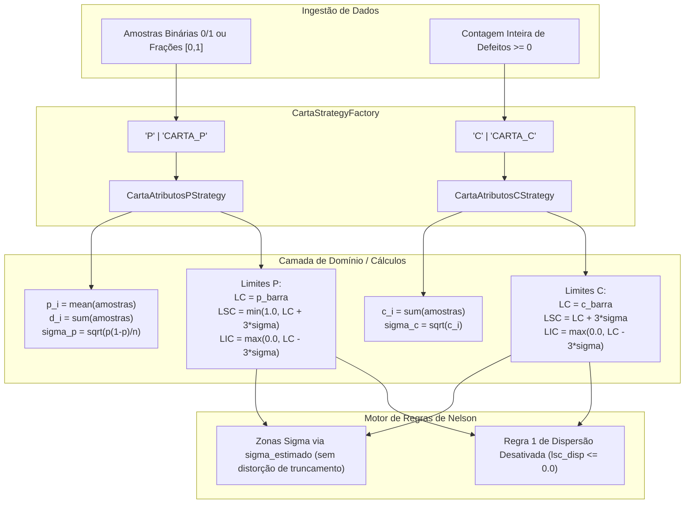

# Cartas de Controle por Atributos (Gráficos P e C)

Este documento descreve a especificação, arquitetura, modelagem matemática e implementação do suporte a **Cartas de Controle Estatístico por Atributos** no backend do Sistema CEP (Controle Estatístico de Processos).

---

## 1. Visão Geral e Fundamentação Teórica

Enquanto cartas de controle por variáveis (como $\bar{X}-R$, $\bar{X}-s$ e $I-MR$) monitoram grandezas dimensionais contínuas (comprimento, diâmetro, torque, temperatura), processos industriais frequentemente exigem o monitoramento de grandezas discretas e contagens de não-conformidades. Para este fim, o sistema suporta duas cartas de controle por atributos consagradas na ISO 7870-2 e no manual AIAG:

1. **Carta P (`tipo_carta = "P"`)**: Monitora a **proporção ou fração de itens defeituosos** em subgrupos de tamanho constante $n$, baseando-se na **Distribuição Binomial**.
2. **Carta C (`tipo_carta = "C"`)**: Monitora a **quantidade total de defeitos ou não-conformidades por lote** ou unidade de inspeção constante, baseando-se na **Distribuição de Poisson**.



---

## 2. Modelagem Matemática Exata

### 2.1. Gráfico P (Distribuição Binomial)

- **Entrada (`amostras: Sequence[float]`)**:
  - *Modo Binário*: Vetor de $n$ medições booleanas/binárias (`0.0` para peça conforme/boa; `1.0` para peça defeituosa/ruim).
  - *Modo Fração Direta*: Vetor com 1 ou mais taxas no intervalo $[0.0, 1.0]$.
  - **Validação de Invariante**: Todos os valores de `amostras` devem ser finitos e satisfazer $0.0 \le x_j \le 1.0$. Caso contrário, lança `ValueError`.

- **Estatística Instantânea do Subgrupo $i$**:
  - Proporção de defeituosos:
    $$p_i = \frac{1}{n}\sum_{j=1}^{n} x_j = \text{mean}(x_j)$$
  - Quantidade absoluta de defeituosos:
    $$d_i = \sum_{j=1}^{n} x_j$$
  - Desvio padrão instantâneo:
    $$\sigma_{p, i} = \sqrt{\frac{p_i(1.0 - p_i)}{n}}$$
  - Armazenamento em `EstatisticasSubgrupo`:
    - `media_x`: $p_i$ (proporção).
    - `amplitude_r`: $d_i$ (contagem inteira de defeituosos).
    - `desvio_s`: $\sigma_{p, i}$ (erro padrão instantâneo).

- **Limites de Controle (a partir de $m$ subgrupos)**:
  - Linha Central ($\text{LC}$):
    $$\bar{p} = \frac{1}{m}\sum_{i=1}^{m} p_i$$
  - Erro Padrão Binomial ($\sigma_p$):
    $$\sigma_p = \sqrt{\frac{\bar{p}(1.0 - \bar{p})}{n}}$$
  - Limite Superior de Controle ($\text{LSC}$):
    $$\text{LSC} = \min\left(1.0,\ \bar{p} + 3.0 \times \sigma_p\right)$$
  - Limite Inferior de Controle ($\text{LIC}$):
    $$\text{LIC} = \max\left(0.0,\ \bar{p} - 3.0 \times \sigma_p\right)$$
  - `sigma_estimado`: $\sigma_p$.
  - Limites de Dispersão: `lc_dispersao = 0.0`, `lsc_dispersao = 0.0`, `lic_dispersao = 0.0`.

### 2.2. Gráfico C (Distribuição de Poisson)

- **Entrada (`amostras: Sequence[float]`)**:
  - Vetor contendo a contagem inteira de defeitos observados no lote. Pode ser um único valor ($n=1$, ex: `[4]`) ou $n$ sub-inspeções cuja soma representa o total do lote ($n>1$, ex: `[1, 0, 2, 1]`, soma = `4`).
  - **Validação de Invariante**: Todos os valores devem ser finitos, não-negativos ($x_j \ge 0.0$) e inteiros (ou equivalentes numéricos como `4.0`). Caso contrário, lança `ValueError`.

- **Estatística Instantânea do Subgrupo $i$**:
  - Total de defeitos no lote $i$:
    $$c_i = \sum_{j=1}^{n} x_j$$
  - Armazenamento em `EstatisticasSubgrupo`:
    - `media_x`: $c_i$ (contagem total de defeitos).
    - `amplitude_r`: $0.0$.
    - `desvio_s`: $\sqrt{c_i}$ (desvio instantâneo de Poisson).

- **Limites de Controle (a partir de $m$ subgrupos)**:
  - Linha Central ($\text{LC}$):
    $$\bar{c} = \frac{1}{m}\sum_{i=1}^{m} c_i$$
  - Desvio Padrão de Poisson ($\sigma_c$):
    $$\sigma_c = \sqrt{\bar{c}}$$
  - Limite Superior de Controle ($\text{LSC}$):
    $$\text{LSC} = \bar{c} + 3.0 \times \sigma_c$$
  - Limite Inferior de Controle ($\text{LIC}$):
    $$\text{LIC} = \max\left(0.0,\ \bar{c} - 3.0 \times \sigma_c\right)$$
  - `sigma_estimado`: $\sigma_c$.
  - Limites de Dispersão: `lc_dispersao = 0.0`, `lsc_dispersao = 0.0`, `lic_dispersao = 0.0`.

---

## 3. Adaptações Arquiteturais e Regras de Negócio

### 3.1. Invariante do Value Object `LimitesControle`
O Value Object `LimitesControle` impõe a invariante matemática:
```python
if not (self.lic <= self.lc <= self.lsc):
    raise ValueError(f"Invariante violada: LIC ({self.lic}) <= LC ({self.lc}) <= LSC ({self.lsc})")
```
Em processos com baixa taxa de defeituosos ou poucas não-conformidades ($\bar{p} < 3\sigma_p$ ou $\bar{c} < 9$), a fórmula clássica $\text{LC} - 3\sigma$ resulta em número negativo. O truncamento em `0.0` garante que a invariante nunca seja violada, mantendo `lic = 0.0 <= lc <= lsc`.

### 3.2. Cálculo de Zonas Sigma nas Regras de Nelson
Devido ao truncamento do `LIC` em `0.0` (ou `LSC` em `1.0`), a distância entre $\text{LC}$ e $\text{LIC}$ pode ser estritamente inferior a $3\sigma$.
Se o cálculo da largura de 1 sigma fosse feito via amplitude total $(\text{LSC} - \text{LIC}) / 6.0$, as zonas sigma seriam artificialmente comprimidas, gerando falsos positivos nas regras de Nelson 5, 6, 7 e 8.

Foi implementada a função auxiliar no motor de regras:
```python
def obter_sigma_zona(limites: LimitesControle) -> float:
    if limites.sigma_estimado > 0.0:
        return limites.sigma_estimado
    return (limites.lsc - limites.lc) / 3.0
```
Todas as regras que dependem da definição de zonas $\pm 1\sigma$ e $\pm 2\sigma$ utilizam `obter_sigma_zona`, garantindo calibração estatística fidedigna.

### 3.3. Desativação da Regra de Dispersão para Atributos
Cartas P e C não possuem gráfico secundário de dispersão (amplitude $R$ ou desvio $s$). Para evitar falsos disparos da `RegraDispersaoForaLimites` (`REGRA_1_DISP`), a regra inclui a salvaguarda:
```python
if lsc_disp <= 0.0:
    return None
```
Adicionalmente, na entidade `CartaControle` durante o recálculo retroativo de histórico (`reavaliar_historico_completo`):
```python
dispersoes_ate_idx = (
    []
    if self.tipo_carta in ("P", "C")
    else [sg.estatisticas.amplitude_r for sg in subgrupos_ordenados[: idx + 1]]
)
```

### 3.4. Opcionalidade de Limites de Especificação de Engenharia
Cartas de atributos frequentemente não possuem Limite Superior de Especificação ($\text{LSE}$) nem Limite Inferior de Especificação ($\text{LIE}$).
No endpoint `POST /api/v1/cartas/`, a criação de cartas passou a aceitar `lse = None` e `lie = None` sem exigir tolerâncias de engenharia que não se aplicam a contagens de defeitos.

### 3.5. Suporte a Amostras Escalares no Simulador e Ingestão
Ao importar dados de cartas P e C (por exemplo, contagens por lote `[3, 4, 1, 0, 5]`), o schema de validação (`extrair_amostras`) e o simulador JSON (`simulador_json.py`) normalizam automaticamente listas unidimensionais de números escalares para vetores de subgrupos `[[3.0], [4.0], [1.0], [0.0], [5.0]]`.

---

## 4. Matriz de Rastreabilidade de Testes

Os testes automatizados foram consolidados em `backend/tests/domain/test_cartas_atributos.py` e `backend/tests/unit/cep/test_p_c_charts.py`.

| ID Teste | Descrição do Cenário | Entrada / Parâmetros | Resultado Esperado | Status |
| :--- | :--- | :--- | :--- | :--- |
| `test_carta_p_calibracao_exata` | Calibração P (Prompt 6.1) | 5 subgrupos de $n=10$, histórico com médias $[0.1, 0.2, 0.1, 0.0, 0.1]$ | $\bar{p} = 0.100$, $\sigma_p = 0.09487$, $\text{LSC} = 0.3846$, $\text{LIC} = 0.0$ | **PASSOU** |
| `test_carta_p_truncamento_lsc` | Truncamento Superior P | $n=10$, histórico com médias $[0.8, 0.9, 0.7, 0.8, 0.9]$ | $\bar{p} = 0.820$, $\text{LSC} = 1.0$ (truncado em 100%) | **PASSOU** |
| `test_carta_p_validacao_amostras` | Validação de Entrada P | Amostras com valores $< 0.0$ ou $> 1.0$ | Lança `ValueError` com mensagem descritiva | **PASSOU** |
| `test_carta_c_calibracao_exata` | Calibração C (Prompt 6.2) | 5 subgrupos: `[4]`, `[2]`, `[5]`, `[3]`, `[6]` | $\bar{c} = 4.000$, $\sigma_c = 2.000$, $\text{LSC} = 10.000$, $\text{LIC} = 0.0$ | **PASSOU** |
| `test_carta_c_validacao_inteiros` | Validação de Entrada C | Amostra com valor negativo `-1` ou fracionário `2.5` | Lança `ValueError` com mensagem descritiva | **PASSOU** |
| `test_carta_c_sem_truncamento_lic` | Ausência de Truncamento C | 5 subgrupos com média $\bar{c} = 16.0$ | $\bar{c} = 16.0$, $\sigma_c = 4.0$, $\text{LSC} = 28.0$, $\text{LIC} = 4.0 > 0.0$ | **PASSOU** |
| `test_limites_dispersao_zerados` | Dispersão Desativada | Cartas P e C calculando limites de controle | `lc_dispersao = 0.0`, `lsc_dispersao = 0.0`, `lic_dispersao = 0.0` | **PASSOU** |
| `test_regra_dispersao_nao_dispara` | Supressão de Alarme Disp | Subgrupo de atributo com $R=0$ ou $s=0$ | Nenhuma violação `REGRA_1_DISP` gerada | **PASSOU** |
