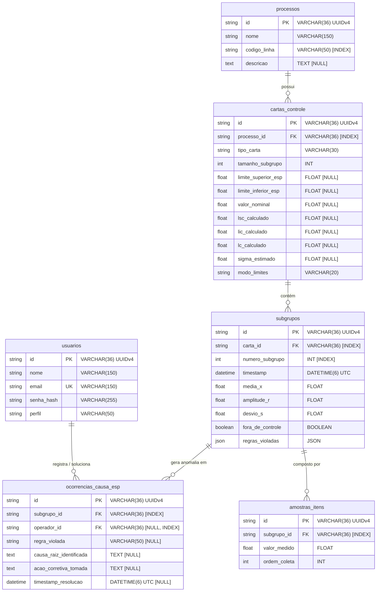

# Modelagem do Banco de Dados - Sistema de Controle Estatístico de Processos (CEP)

Este documento descreve detalhadamente a arquitetura de persistência, modelagem relacional, dicionário de dados, restrições de integridade e decisões de projeto do banco de dados do **Sistema de Controle Estatístico de Processos (CEP)**.

---

## 1. Visão Geral da Arquitetura de Dados

O banco de dados foi projetado para atender aos requisitos de alta performance em ingestão de telemetria industrial, análise estatística em tempo real e integridade transacional rigorosa (**ACID**).

### 1.1. Tecnologias e Configurações de Infraestrutura

* **SGBD:** MySQL 8.0
* **Storage Engine:** InnoDB (garantia de suporte a transações ACID, chaves estrangeiras e row-level locking)
* **Conjunto de Caracteres (Charset):** `utf8mb4`
* **Collation:** `utf8mb4_unicode_ci` (compatibilidade internacional e precisão em comparações textuais)
* **Driver de Conexão Backend:** `asyncmy` integrado ao **SQLAlchemy 2.0** assíncrono (`AsyncEngine` / `AsyncSession`)
* **Gerenciador de Migrações:** Alembic (gerenciamento declarativo e versionado do ciclo de vida DDL)

### 1.2. Objetivos e Princípios da Modelagem

1. **Separação entre Amostras Individuais e Agregações:** Armazenamento das leituras brutas unitárias (`amostras_itens`) associadas ao seu respectivo subgrupo amostral (`subgrupos`), permitindo tanto o recálculo retrospectivo quanto a auditoria pontual de cada medição de chão de fábrica.
2. **Desnormalização Controlada para Séries Temporais:** Persistência de métricas sumarizadas do subgrupo ($\bar{X}$, $R$, $s$, flag `fora_de_controle`) diretamente na tabela `subgrupos`. Isso viabiliza consultas ultra-rápidas para plotagem de gráficos em tempo real e regras de Nelson sem necessidade de computação em tempo de consulta sobre milhões de registros de amostras.
3. **Persistência de Limites de Controle e Engenharia:** Manutenção dos limites calculados ($\text{LSC}$, $\text{LIC}$, $\text{LC}$, $\hat{\sigma}$) na tabela `cartas_controle`, servindo como parâmetros estáveis de comparação contra os limites de especificação técnica de engenharia ($\text{LSE}$, $\text{LIE}$, $\text{Nominal}$).
4. **Armazenamento Híbrido Relacional e Semiestruturado (JSON):** Uso de colunas `JSON` nativas do MySQL 8.0 para serialização de eventos de violação de regras de Nelson (`regras_violadas`), permitindo armazenar dinamicamente metadados variáveis de anomalias sem overhead de tabelas associativas adicionais.
5. **Rastreabilidade e Fechamento de Ciclo (CAPA):** Tabela de ocorrências de causas especiais (`ocorrencias_causa_esp`) conectada a operadores humanos (`usuarios`) para registrar causa raiz e ações corretivas em conformidade com as normas de gestão da qualidade (ISO 9001 / IATF 16949).

---

## 2. Diagrama Entidade-Relacionamento (ERD)

### 2.1. Diagrama Lógico em Notação Mermaid



### 2.2. Diagrama de Relacionamento em Texto Estruturado

```text
  [usuarios] (1)
      │
      │ 0..N (operador_id) [ON DELETE SET NULL]
      ▼
  [ocorrencias_causa_esp] (0..N)
      ▲
      │ 0..N (subgrupo_id) [ON DELETE CASCADE]
      │
  [processos] (1)
      │
      │ 1..N (processo_id) [ON DELETE CASCADE]
      ▼
  [cartas_controle] (1)
      │
      │ 1..N (carta_id) [ON DELETE CASCADE]
      ▼
  [subgrupos] (1)
      │
      │ 1..N (subgrupo_id) [ON DELETE CASCADE]
      ▼
  [amostras_itens] (1..N)
```

---

## 3. Dicionário de Dados Completo

Abaixo constam as especificações exatas de cada tabela física, tipos de dados, chaves, índices, restrições e finalidades operacionais.

### 3.1. Tabela `usuarios`
Armazena as credenciais, dados cadastrais e perfis de autorização dos usuários do sistema (administradores, engenheiros da qualidade e operadores de linha).

| Coluna | Tipo Físico (MySQL) | Tipo SQLAlchemy | Nulo? | Chaves / Restrições | Descrição e Regras de Negócio |
| :--- | :--- | :--- | :---: | :---: | :--- |
| `id` | `VARCHAR(36)` | `String(36)` | **Não** | **PK** | Identificador único universal (UUIDv4) gerado na criação do usuário. |
| `nome` | `VARCHAR(150)` | `String(150)` | **Não** | - | Nome completo do colaborador ou operador. |
| `email` | `VARCHAR(150)` | `String(150)` | **Não** | **UK** (`ix_usuarios_email`) | Endereço de e-mail institucional utilizado como login/username único. Indexado para autenticação instantânea. |
| `senha_hash` | `VARCHAR(255)` | `String(255)` | **Não** | - | Hash criptográfico seguro da senha (bcrypt / Argon2). Nunca armazena senha em texto plano. |
| `perfil` | `VARCHAR(50)` | `String(50)` | **Não** | Default: `'OPERADOR'` | Nível de privilégio e controle de acesso baseado em papéis (RBAC): `ADMIN`, `ENGENHEIRO`, `OPERADOR`. |

* **Relacionamentos ORM (`UsuarioModel`):**
  * `ocorrencias`: Relação 1:N com `OcorrenciaCausaEspModel` via `back_populates="operador"`, estratégia `selectin`.

---

### 3.2. Tabela `processos`
Representa as linhas de montagem, máquinas, células de fabricação ou processos industriais monitorados estatisticamente pelo CEP.

| Coluna | Tipo Físico (MySQL) | Tipo SQLAlchemy | Nulo? | Chaves / Restrições | Descrição e Regras de Negócio |
| :--- | :--- | :--- | :---: | :---: | :--- |
| `id` | `VARCHAR(36)` | `String(36)` | **Não** | **PK** | Identificador único universal (UUIDv4) do processo. |
| `nome` | `VARCHAR(150)` | `String(150)` | **Não** | - | Nome amigável do processo (ex: "Usinagem CNC Bloco de Motor"). |
| `codigo_linha` | `VARCHAR(50)` | `String(50)` | **Não** | **Index** (`ix_processos_codigo_linha`) | Código mnemônico ou tag identificadora da linha de produção (ex: `LINHA-01`, `PRENSA-B2`). Indexado para filtragem rápida. |
| `descricao` | `TEXT` | `Text` | Sim | - | Detalhamento operacional, especificações da máquina ou contexto de fabricação. |

* **Relacionamentos ORM (`ProcessoModel`):**
  * `cartas`: Relação 1:N com `CartaControleModel` via `back_populates="processo"`, `cascade="all, delete-orphan"`, estratégia `selectin`. Se o processo for removido, todas as suas cartas e séries associadas são eliminadas em cascata.

---

### 3.3. Tabela `cartas_controle`
Armazena a parametrização de uma carta de controle estatístico (variáveis ou atributos), limites de especificação de engenharia e os limites de controle calculados pelo motor CEP.

| Coluna | Tipo Físico (MySQL) | Tipo SQLAlchemy | Nulo? | Chaves / Restrições | Descrição e Regras de Negócio |
| :--- | :--- | :--- | :---: | :---: | :--- |
| `id` | `VARCHAR(36)` | `String(36)` | **Não** | **PK** | Identificador único universal (UUIDv4) da carta. |
| `processo_id` | `VARCHAR(36)` | `String(36)` | **Não** | **FK** -> `processos.id`, **Index** (`ix_cartas_controle_processo_id`) | Chave estrangeira referenciando o processo pai. Configurada com `ON DELETE CASCADE`. |
| `tipo_carta` | `VARCHAR(30)` | `String(30)` | **Não** | - | Tipo da carta de controle: `X_R` (Média e Amplitude), `X_S` (Média e Desvio Padrão), `I_MR` (Valores Individuais e Amplitude Móvel), `P`, `NP`, `C`, `U`. |
| `tamanho_subgrupo` | `INT` | `Integer` | **Não** | - | Tamanho nominal da amostra coletada por subgrupo ($n \ge 1$). Subgrupos com $n=1$ acionam cartas $I-MR$; $n \le 10$ cartas $\bar{X}-R$; $n > 10$ cartas $\bar{X}-s$. |
| `limite_superior_esp` | `FLOAT` | `Float` | Sim | - | Limite Superior de Especificação ($\text{LSE}$ / $\text{USL}$) definido pela Engenharia de Produto. Utilizado no cálculo de $C_p$ e $C_{pk}$. |
| `limite_inferior_esp` | `FLOAT` | `Float` | Sim | - | Limite Inferior de Especificação ($\text{LIE}$ / $\text{LSL}$) de Engenharia. Utilizado no cálculo de $C_p$ e $C_{pk}$. |
| `valor_nominal` | `FLOAT` | `Float` | Sim | - | Valor nominal central almejado pelo projeto do produto ($\text{Target}$). |
| `lsc_calculado` | `FLOAT` | `Float` | Sim | - | Limite Superior de Controle ($\text{LSC}$ / $\text{UCL}$) resultante do cálculo estatístico a partir dos subgrupos. |
| `lic_calculado` | `FLOAT` | `Float` | Sim | - | Limite Inferior de Controle ($\text{LIC}$ / $\text{LCL}$) resultante do cálculo estatístico a partir dos subgrupos. |
| `lc_calculado` | `FLOAT` | `Float` | Sim | - | Linha Central ($\text{LC}$ / $\text{CL}$) calculada estatisticamente (ex: Grande Média $\bar{\bar{X}}$ ou $\bar{X}$). |
| `sigma_estimado` | `FLOAT` | `Float` | Sim | - | Estimativa da variabilidade do processo ($\hat{\sigma} = \bar{R}/d_2$ ou $\bar{s}/c_4$). |
| `modo_limites` | `VARCHAR(20)` | `String(20)` | **Não** | Default: `'DINAMICO'` | Estratégia de recálculo dos limites: `'DINAMICO'` (recalculado a cada novo subgrupo) ou `'FIXO'` (limites congelados de uma fase de calibração). |

* **Relacionamentos ORM (`CartaControleModel`):**
  * `processo`: Relação N:1 com `ProcessoModel` (`back_populates="cartas"`).
  * `subgrupos`: Relação 1:N com `SubgrupoModel` (`back_populates="carta"`, `cascade="all, delete-orphan"`, ordenado por `numero_subgrupo`).

---

### 3.4. Tabela `subgrupos`
Representa um evento amostral coletado em determinado instante no tempo. Contém os valores sumarizados de posição e dispersão, o status de estabilidade e as anomalias detectadas pelas Regras de Nelson.

| Coluna | Tipo Físico (MySQL) | Tipo SQLAlchemy | Nulo? | Chaves / Restrições | Descrição e Regras de Negócio |
| :--- | :--- | :--- | :---: | :---: | :--- |
| `id` | `VARCHAR(36)` | `String(36)` | **Não** | **PK** | Identificador único universal (UUIDv4) do subgrupo. |
| `carta_id` | `VARCHAR(36)` | `String(36)` | **Não** | **FK** -> `cartas_controle.id`, **Index** (`ix_subgrupos_carta_id`) | Chave estrangeira com `ON DELETE CASCADE`. Indexada para recuperação rápida do histórico da carta. |
| `numero_subgrupo` | `INT` | `Integer` | **Não** | **Index** (`ix_subgrupos_numero_subgrupo`) | Sequencial cronológico da amostra ($1, 2, 3, \dots$). Indexado para ordenação temporal rápida. |
| `timestamp` | `DATETIME(6)` | `DateTime(timezone=True)` | **Não** | Default: `now(UTC)` | Carimbo temporal UTC de alta precisão registrando o exato momento da coleta/ingestão. |
| `media_x` | `FLOAT` | `Float` | **Não** | - | Média aritmética das medições do subgrupo ($\bar{X} = \frac{1}{n} \sum x_i$). |
| `amplitude_r` | `FLOAT` | `Float` | **Não** | - | Amplitude amostral ($R = x_{\max} - x_{\min}$) das medições do subgrupo. |
| `desvio_s` | `FLOAT` | `Float` | **Não** | - | Desvio padrão amostral ($s = \sqrt{\frac{\sum(x_i - \bar{X})^2}{n-1}}$) do subgrupo. |
| `fora_de_controle` | `BOOLEAN` | `Boolean` | **Não** | Default: `False` | Flag booleana indicando se o subgrupo violou qualquer uma das regras estatísticas de controle. |
| `regras_violadas` | `JSON` | `JSON().with_variant(MySQLJSON, 'mysql')` | **Não** | Default: `'[]'` | Lista serializada em formato JSON das regras violadas (ex: código da regra de Nelson, descrição, pontos violadores). |

* **Restrições de Unicidade Composta:**
  * `uq_subgrupo_carta_numero`: `UNIQUE (carta_id, numero_subgrupo)` — Garante que não ocorra duplicidade na numeração sequencial de subgrupos para uma mesma carta de controle, assegurando idempotência na ingestão.
* **Relacionamentos ORM (`SubgrupoModel`):**
  * `carta`: Relação N:1 com `CartaControleModel`.
  * `amostras`: Relação 1:N com `AmostraItemModel` (`cascade="all, delete-orphan"`, ordenado por `ordem_coleta`).
  * `ocorrencias`: Relação 1:N com `OcorrenciaCausaEspModel` (`cascade="all, delete-orphan"`).

---

### 3.5. Tabela `amostras_itens`
Contém as leituras individuais primitivas de cada peça ou item físico medido que compõe o subgrupo amostral.

| Coluna | Tipo Físico (MySQL) | Tipo SQLAlchemy | Nulo? | Chaves / Restrições | Descrição e Regras de Negócio |
| :--- | :--- | :--- | :---: | :---: | :--- |
| `id` | `VARCHAR(36)` | `String(36)` | **Não** | **PK** | Identificador único universal (UUIDv4) do item medido. |
| `subgrupo_id` | `VARCHAR(36)` | `String(36)` | **Não** | **FK** -> `subgrupos.id`, **Index** (`ix_amostras_itens_subgrupo_id`) | Chave estrangeira com `ON DELETE CASCADE`. Indexada para carregamento de medições vinculadas. |
| `valor_medido` | `FLOAT` | `Float` | **Não** | - | Valor escalar contínuo ou discreto da medição (ex: espessura, peso, diâmetro, torque). |
| `ordem_coleta` | `INT` | `Integer` | **Não** | - | Posição ordinal do item na sequência de medição do subgrupo ($1, 2, \dots, n$). |

* **Relacionamentos ORM (`AmostraItemModel`):**
  * `subgrupo`: Relação N:1 com `SubgrupoModel` (`back_populates="amostras"`).

---

### 3.6. Tabela `ocorrencias_causa_esp`
Registra o fluxo de investigação de causas especiais e aplicação de planos de ação corretiva sempre que um subgrupo apresenta comportamento fora de controle estatístico.

| Coluna | Tipo Físico (MySQL) | Tipo SQLAlchemy | Nulo? | Chaves / Restrições | Descrição e Regras de Negócio |
| :--- | :--- | :--- | :---: | :---: | :--- |
| `id` | `VARCHAR(36)` | `String(36)` | **Não** | **PK** | Identificador único universal (UUIDv4) da ocorrência. |
| `subgrupo_id` | `VARCHAR(36)` | `String(36)` | **Não** | **FK** -> `subgrupos.id`, **Index** (`ix_ocorrencias_causa_esp_subgrupo_id`) | Subgrupo em que a anomalia ocorreu. Configurado com `ON DELETE CASCADE`. |
| `operador_id` | `VARCHAR(36)` | `String(36)` | Sim | **FK** -> `usuarios.id`, **Index** (`ix_ocorrencias_causa_esp_operador_id`) | Operador ou engenheiro responsável pelo apontamento ou resolução. Configurado com `ON DELETE SET NULL`. |
| `regra_violada` | `VARCHAR(50)` | `String(50)` | Sim | - | Mnemônico da regra violada que motivou o plano de ação (ex: `REGRA_1_FORA_3SIGMA`, `REGRA_2_ZONA_A`). |
| `causa_raiz_identificada` | `TEXT` | `Text` | Sim | - | Diagnóstico técnico da causa especial identificada (ex: desgaste de ferramenta, oscilação de temperatura, lote de matéria-prima). |
| `acao_corretiva_tomada` | `TEXT` | `Text` | Sim | - | Ação corretiva executada para estabilização do processo (ex: troca de inserto de corte, recalibração de sensor). |
| `timestamp_resolucao` | `DATETIME(6)` | `DateTime(timezone=True)` | Sim | - | Data/hora em que a ação corretiva foi concluída e o processo foi liberado. |

* **Relacionamentos ORM (`OcorrenciaCausaEspModel`):**
  * `subgrupo`: Relação N:1 com `SubgrupoModel` (`back_populates="ocorrencias"`).
  * `operador`: Relação N:1 com `UsuarioModel` (`back_populates="ocorrencias"`).

---

## 4. Estratégias de Indexação e Desempenho

A indexação foi planejada considerando as consultas críticas do ciclo de vida do CEP:

```text
               Ingestão de Dados (POST /amostras)
                                │
                                ▼
 ┌─────────────────────────────────────────────────────────────┐
 │ 1. Busca da Carta: WHERE id = :carta_id                     │ -> PK Index (O(1))
 │ 2. Validação de Unicidade: (carta_id, numero_subgrupo)      │ -> Unique Composite Index
 │ 3. Busca dos últimos N subgrupos:                           │
 │    WHERE carta_id = :id ORDER BY numero_subgrupo DESC       │ -> Composite B-Tree Scan
 │ 4. Persistência em lote das amostras brutas:                │
 │    INSERT INTO amostras_itens (subgrupo_id, ...)            │ -> Foreign Key Index
 └─────────────────────────────────────────────────────────────┘
```

### 4.1. Resumo dos Índices Físicos

| Tabela | Nome do Índice | Colunas | Tipo | Objetivo / Justificativa |
| :--- | :--- | :--- | :---: | :--- |
| `usuarios` | `PRIMARY` | `id` | B-Tree (PK) | Busca pontual e integridade primária. |
| `usuarios` | `ix_usuarios_email` | `email` | B-Tree (Unique) | Autenticação por e-mail em $O(1)$ e garantia de e-mail único. |
| `processos` | `PRIMARY` | `id` | B-Tree (PK) | Busca primária por UUID. |
| `processos` | `ix_processos_codigo_linha` | `codigo_linha` | B-Tree | Filtros por código de linha em relatórios e dashboards. |
| `cartas_controle` | `PRIMARY` | `id` | B-Tree (PK) | Acesso direto pelo ID da carta no WebSocket e REST. |
| `cartas_controle` | `ix_cartas_controle_processo_id` | `processo_id` | B-Tree | Listagem de todas as cartas associadas a um processo fabril. |
| `subgrupos` | `PRIMARY` | `id` | B-Tree (PK) | Chave primária. |
| `subgrupos` | `ix_subgrupos_carta_id` | `carta_id` | B-Tree | Carregamento da série temporal histórica de uma carta. |
| `subgrupos` | `ix_subgrupos_numero_subgrupo`| `numero_subgrupo` | B-Tree | Ordenação sequencial cronológica das amostras. |
| `subgrupos` | `uq_subgrupo_carta_numero` | `(carta_id, numero_subgrupo)` | B-Tree (Unique) | Prevenção de colisões e ordenação otimizada por carta. |
| `amostras_itens` | `PRIMARY` | `id` | B-Tree (PK) | Chave primária. |
| `amostras_itens` | `ix_amostras_itens_subgrupo_id`| `subgrupo_id` | B-Tree | Junção e recuperação das leituras brutas de um subgrupo. |
| `ocorrencias_causa_esp` | `PRIMARY` | `id` | B-Tree (PK) | Chave primária. |
| `ocorrencias_causa_esp` | `ix_ocorrencias_causa_esp_subgrupo_id` | `subgrupo_id` | B-Tree | Busca de causas registradas sobre pontos com anomalias. |
| `ocorrencias_causa_esp` | `ix_ocorrencias_causa_esp_operador_id` | `operador_id` | B-Tree | Filtro de ações tomadas por operador específico. |

---

## 5. Decisões Arquiteturais e Padrões de Modelagem

### 5.1. Chaves Primárias: UUID (VARCHAR(36)) vs Inteiros Auto-Incremento
* **Decisão:** Adoção de **UUIDv4** representado como `VARCHAR(36)` para todas as entidades.
* **Motivação Técnica:**
  1. Permite geração distribuída de chaves em nós de ingestão ou no próprio cliente (Edge/IoT) antes mesmo do envio ao banco.
  2. Impossibilita ataques de enumeração sequencial de recursos na API pública (`/api/v1/cartas/{id}`).
  3. Facilita migração e fusão de dados entre múltiplos ambientes fabris sem risco de conflito de IDs.

### 5.2. Persistência Polimórfica de Violações: Estrutura JSON Nativa
* As 8 Regras de Nelson possuem diferentes quantitativos de parâmetros e contextos (ex: a Regra 1 envolve 1 ponto fora de $3\sigma$, enquanto a Regra 2 envolve uma sequência de 9 pontos consecutivos no mesmo lado da linha central).
* A coluna `regras_violadas` do tipo `JSON` armazena estruturas flexíveis serializadas:
  ```json
  [
    {
      "codigo_regra": "REGRA_1",
      "descricao": "1 ponto além da Zona A (mais de 3 sigma da Linha Central).",
      "numero_subgrupo": 25,
      "pontos_violadores": [28.45]
    },
    {
      "codigo_regra": "REGRA_2",
      "descricao": "9 pontos consecutivos do mesmo lado da Linha Central.",
      "numero_subgrupo": 25,
      "pontos_violadores": [26.1, 26.3, 26.4, 26.2, 26.8, 26.5, 26.9, 27.1, 28.45]
    }
  ]
  ```
* **Benefício:** Evita junções pesadas com tabelas adicionais e simplifica a serialização direta para o payload transmitido via WebSocket (`/ws/cartas/{carta_id}`).

### 5.3. Estratégia de Deleção em Cascata (`ON DELETE`)
* **`CASCADE` no fluxo Produtivo:** Se uma carta de controle ou um processo for excluído, todos os dados estatísticos derivados (`subgrupos`, `amostras_itens` e `ocorrencias_causa_esp`) são automaticamente removidos pelo InnoDB, prevenindo registros órfãos.
* **`SET NULL` em Usuários:** Se um operador for desligado e seu cadastro excluído da tabela `usuarios`, os registros históricos de causa raiz e ação corretiva em `ocorrencias_causa_esp` são **preservados**, definindo `operador_id = NULL`. Isso atende aos requisitos de auditoria industrial e normas regulatórias.

### 5.4. Padrão Data Mapper e Desacoplamento do Domínio
* As classes SQLAlchemy (`*Model`) na camada de infraestrutura (`app/infrastructure/persistence/models`) são estritamente separadas das entidades puras de domínio (`app/domain/entities`).
* A camada de mapeamento (`app/infrastructure/persistence/mappers.py`) garante que regras de negócio, invariantes de domínio e cálculos estatísticos (NumPy/SciPy) nunca dependam de acoplamento direto com o ORM.

---

## 6. DDL de Criação (Alembic Migration Reference)

O esquema do banco é gerado a partir da migração inicial do Alembic (`656b5cdd1144_criar_tabelas_iniciais_cep.py`). O script SQL DDL correspondente para MySQL 8.0 é apresentado abaixo:

```sql
-- 1. Criação da Tabela de Usuários
CREATE TABLE usuarios (
    id VARCHAR(36) NOT NULL,
    nome VARCHAR(150) NOT NULL,
    email VARCHAR(150) NOT NULL,
    senha_hash VARCHAR(255) NOT NULL,
    perfil VARCHAR(50) NOT NULL DEFAULT 'OPERADOR',
    PRIMARY KEY (id)
) ENGINE=InnoDB DEFAULT CHARSET=utf8mb4 COLLATE=utf8mb4_unicode_ci;

CREATE UNIQUE INDEX ix_usuarios_email ON usuarios (email);

-- 2. Criação da Tabela de Processos
CREATE TABLE processos (
    id VARCHAR(36) NOT NULL,
    nome VARCHAR(150) NOT NULL,
    codigo_linha VARCHAR(50) NOT NULL,
    descricao TEXT NULL,
    PRIMARY KEY (id)
) ENGINE=InnoDB DEFAULT CHARSET=utf8mb4 COLLATE=utf8mb4_unicode_ci;

CREATE INDEX ix_processos_codigo_linha ON processos (codigo_linha);

-- 3. Criação da Tabela de Cartas de Controle
CREATE TABLE cartas_controle (
    id VARCHAR(36) NOT NULL,
    processo_id VARCHAR(36) NOT NULL,
    tipo_carta VARCHAR(30) NOT NULL,
    tamanho_subgrupo INT NOT NULL,
    limite_superior_esp FLOAT NULL,
    limite_inferior_esp FLOAT NULL,
    valor_nominal FLOAT NULL,
    lsc_calculado FLOAT NULL,
    lic_calculado FLOAT NULL,
    lc_calculado FLOAT NULL,
    sigma_estimado FLOAT NULL,
    modo_limites VARCHAR(20) NOT NULL DEFAULT 'DINAMICO',
    PRIMARY KEY (id),
    CONSTRAINT fk_cartas_controle_processo_id 
        FOREIGN KEY (processo_id) REFERENCES processos (id) ON DELETE CASCADE
) ENGINE=InnoDB DEFAULT CHARSET=utf8mb4 COLLATE=utf8mb4_unicode_ci;

CREATE INDEX ix_cartas_controle_processo_id ON cartas_controle (processo_id);

-- 4. Criação da Tabela de Subgrupos Amostrais
CREATE TABLE subgrupos (
    id VARCHAR(36) NOT NULL,
    carta_id VARCHAR(36) NOT NULL,
    numero_subgrupo INT NOT NULL,
    timestamp DATETIME(6) NOT NULL,
    media_x FLOAT NOT NULL,
    amplitude_r FLOAT NOT NULL,
    desvio_s FLOAT NOT NULL,
    fora_de_controle BOOLEAN NOT NULL DEFAULT 0,
    regras_violadas JSON NOT NULL,
    PRIMARY KEY (id),
    CONSTRAINT uq_subgrupo_carta_numero UNIQUE (carta_id, numero_subgrupo),
    CONSTRAINT fk_subgrupos_carta_id 
        FOREIGN KEY (carta_id) REFERENCES cartas_controle (id) ON DELETE CASCADE
) ENGINE=InnoDB DEFAULT CHARSET=utf8mb4 COLLATE=utf8mb4_unicode_ci;

CREATE INDEX ix_subgrupos_carta_id ON subgrupos (carta_id);
CREATE INDEX ix_subgrupos_numero_subgrupo ON subgrupos (numero_subgrupo);

-- 5. Criação da Tabela de Amostras / Itens Medidos
CREATE TABLE amostras_itens (
    id VARCHAR(36) NOT NULL,
    subgrupo_id VARCHAR(36) NOT NULL,
    valor_medido FLOAT NOT NULL,
    ordem_coleta INT NOT NULL,
    PRIMARY KEY (id),
    CONSTRAINT fk_amostras_itens_subgrupo_id 
        FOREIGN KEY (subgrupo_id) REFERENCES subgrupos (id) ON DELETE CASCADE
) ENGINE=InnoDB DEFAULT CHARSET=utf8mb4 COLLATE=utf8mb4_unicode_ci;

CREATE INDEX ix_amostras_itens_subgrupo_id ON amostras_itens (subgrupo_id);

-- 6. Criação da Tabela de Ocorrências de Causa Especial
CREATE TABLE ocorrencias_causa_esp (
    id VARCHAR(36) NOT NULL,
    subgrupo_id VARCHAR(36) NOT NULL,
    operador_id VARCHAR(36) NULL,
    regra_violada VARCHAR(50) NULL,
    causa_raiz_identificada TEXT NULL,
    acao_corretiva_tomada TEXT NULL,
    timestamp_resolucao DATETIME(6) NULL,
    PRIMARY KEY (id),
    CONSTRAINT fk_ocorrencias_causa_esp_subgrupo_id 
        FOREIGN KEY (subgrupo_id) REFERENCES subgrupos (id) ON DELETE CASCADE,
    CONSTRAINT fk_ocorrencias_causa_esp_operador_id 
        FOREIGN KEY (operador_id) REFERENCES usuarios (id) ON DELETE SET NULL
) ENGINE=InnoDB DEFAULT CHARSET=utf8mb4 COLLATE=utf8mb4_unicode_ci;

CREATE INDEX ix_ocorrencias_causa_esp_subgrupo_id ON ocorrencias_causa_esp (subgrupo_id);
CREATE INDEX ix_ocorrencias_causa_esp_operador_id ON ocorrencias_causa_esp (operador_id);
```

---

## 7. Consultas Típicas e Padrões de Acesso

### 7.1. Ingestão de Novo Subgrupo e Amostras Brutas
A inserção de um subgrupo e suas medições brutas ocorre em transação única (`AsyncSession`), garantindo atomicidade:

```sql
-- Inserir o subgrupo sumarizado
INSERT INTO subgrupos (
    id, carta_id, numero_subgrupo, timestamp, 
    media_x, amplitude_r, desvio_s, fora_de_controle, regras_violadas
) VALUES (
    'a1b2c3d4-0000-0000-0000-000000000001',
    'c9e8d7c6-1111-2222-3333-444455556666',
    26,
    UTC_TIMESTAMP(6),
    25.42, 0.85, 0.31, 1,
    '[{"codigo_regra": "REGRA_1", "descricao": "1 ponto além de 3 sigma", "numero_subgrupo": 26}]'
);

-- Inserir os itens individuais associados
INSERT INTO amostras_itens (id, subgrupo_id, valor_medido, ordem_coleta) VALUES
    ('uuid-item-1', 'a1b2c3d4-0000-0000-0000-000000000001', 25.10, 1),
    ('uuid-item-2', 'a1b2c3d4-0000-0000-0000-000000000001', 25.50, 2),
    ('uuid-item-3', 'a1b2c3d4-0000-0000-0000-000000000001', 25.80, 3),
    ('uuid-item-4', 'a1b2c3d4-0000-0000-0000-000000000001', 25.20, 4),
    ('uuid-item-5', 'a1b2c3d4-0000-0000-0000-000000000001', 25.50, 5);
```

### 7.2. Recuperação do Histórico Recente para Avaliação de Regras
Para avaliar regras temporais de estabilidade (ex: 9 pontos consecutivos no mesmo lado da média ou tendências contínuas), o sistema recupera os últimos $N$ registros ordenados:

```sql
SELECT 
    s.id, s.numero_subgrupo, s.timestamp, s.media_x, s.amplitude_r, s.desvio_s, 
    s.fora_de_controle, s.regras_violadas
FROM subgrupos s
WHERE s.carta_id = 'c9e8d7c6-1111-2222-3333-444455556666'
ORDER BY s.numero_subgrupo DESC
LIMIT 30;
```

### 7.3. Auditoria de Causa Especial e Resolução
Consulta para exibir o histórico de anomalias com operador responsável e ações corretivas:

```sql
SELECT 
    p.codigo_linha,
    p.nome AS processo,
    c.tipo_carta,
    s.numero_subgrupo,
    s.media_x,
    o.regra_violada,
    o.causa_raiz_identificada,
    o.acao_corretiva_tomada,
    u.nome AS operador_responsavel,
    o.timestamp_resolucao
FROM ocorrencias_causa_esp o
JOIN subgrupos s ON s.id = o.subgrupo_id
JOIN cartas_controle c ON c.id = s.carta_id
JOIN processos p ON p.id = c.processo_id
LEFT JOIN usuarios u ON u.id = o.operador_id
ORDER BY s.numero_subgrupo DESC;
```

---

## 8. Considerações de Manutenção e Evolução Futura

1. **Particionamento de Tabelas (Partitioning):** Para instalações industriais de alta frequência (milhões de medições por dia), recomenda-se particionar as tabelas `subgrupos` e `amostras_itens` por `RANGE (TO_DAYS(timestamp))` mensal ou trimestral.
2. **Arquivamento e Retenção:** Implementação de job assíncrono para arquivamento de leituras brutas antigas de `amostras_itens` em cold storage após período de conformidade, mantendo os registros sumarizados em `subgrupos`.
3. **Expansão para Atributos:** O modelo já suporta diretamente cartas de atributos ($p, np, c, u$) mapeando a proporção ou contagem amostral na coluna `media_x` ou campos complementares, sem necessidade de quebra de schema.
