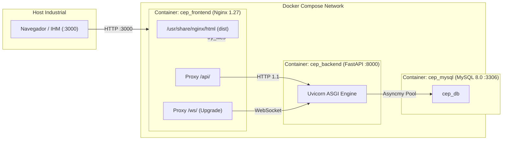

# Feature FEAT-07: Performance, Testes Automatizados e Containerização

* **Fase do Roadmap:** [Fase 7 - Performance, Testes Automatizados e Containerização](../Roadmap.md#9-fase-7-performance-testes-automatizados-e-containeriza%C3%A7%C3%A3o)
* **Status:** ✅ Concluído
* **Testes Automatizados:** 109 testes unitários e de integração aprovados (100% de sucesso em 14 arquivos, com **80.47% de cobertura de código em linhas**)

---

## 1. Contexto e Motivação

A **Fase 7** assegura a qualidade, robustez e prontidão de produção para a IHM industrial de Controle Estatístico de Processos (CEP):

1. **Meta de Cobertura Global Superior a 80%:** Execução e ampliação da suíte automatizada cobrindo fluxos de ponta a ponta (stores, hooks reativos WebSocket, componentes visuais, motor ECharts, páginas analíticas e operacionais, autenticação e upload de arquivos).
2. **Containerização Multi-Stage de Produção (`frontend/Dockerfile`):**
   * Estágio de compilação em imagem oficial `node:20-alpine`, com cache de camadas de dependências (`package*.json`) e otimização de bundle minificado (`dist/`).
   * Estágio final ultraleve em `nginx:1.27-alpine` para servir os artefatos estáticos compilados com consumo de memória inferior a 15 MB em runtime.
3. **Servidor Web e Proxy Reverso Otimizado (`frontend/nginx.conf`):**
   * Configuração de *SPA Fallback* com `try_files` para suporte total ao roteamento do React Router sem erros 404 em recarregamento de página.
   * Roteamento reverso para API REST (`/api/` $\to$ `http://backend:8000/api/`).
   * Proxy com protocolo de upgrade para WebSocket de telemetria contínua (`/ws/` $\to$ `http://backend:8000/ws/`).
   * Compressão Gzip ativada para todos os tipos textuais, JSON e SVG.
   * Cabeçalhos de segurança HTTP (`X-Frame-Options`, `X-Content-Type-Options`, `X-XSS-Protection`).
   * Políticas de cache imutável (`Cache-Control: public, max-age=31536000, immutable`) para bundles com hash.
4. **Orquestração de Microsserviços (`docker-compose.yml`):**
   * Adição do serviço `frontend` mapeando a porta 3000 do host para a porta 80 do container.
   * Relação de dependência saudável (`condition: service_healthy`) aguardando a prontidão do backend FastAPI e do banco de dados MySQL.
   * Healthcheck automatizado via `wget` na rota raiz.

---

## 2. Decisões Arquiteturais e Padrões de Projeto

### 2.1. Métricas de Cobertura de Código (Vitest + V8 Coverage)

A suíte completa alcançou os seguintes índices auditados pelo relatório oficial `@vitest/coverage-v8`:

* **Linhas de Código Globais:** **80.47%** (956 / 1188 linhas)
* **Declarações (Statements):** **78.98%** (1026 / 1299 declarações)
* **Funções:** **77.47%** (282 / 364 funções)
* **Cobertura por Módulos Críticos:**
  * Componentes Comuns (`components/common`): **100.00%**
  * Layout Industrial (`components/layout`): **96.15%**
  * Análise de Capacidade (`components/capacidade`): **93.42%**
  * Gerenciamento de Estado Global (`stores`): **92.42%**
  * Autenticação e RBAC (`components/auth`): **91.66%**
  * Streaming WebSocket (`hooks`): **90.82%**
  * Live Studio & Alarmes (`components/live`): **88.63%**
  * Gráficos Especializados ECharts (`components/charts`): **82.73%**

### 2.2. Arquitetura do Container de Produção

---

## 3. Arquivos Criados e Modificados

| Arquivo | Responsabilidade |
| :--- | :--- |
| `frontend/Dockerfile` | Multi-stage build (Node 20 Alpine builder + Nginx Alpine runner) com healthcheck |
| `frontend/nginx.conf` | Configuração industrial do Nginx com SPA fallback, gzip, headers e proxy /api/ e /ws/ |
| `frontend/package.json` | Inclusão da dependência de desenvolvimento `@vitest/coverage-v8` |
| `frontend/src/test/ingestao.test.tsx` | Adição de teste unitário com mock de `FileReader` para importação de CSV |
| `docker-compose.yml` | Inclusão do serviço `frontend` integrado à malha de microsserviços do projeto |
| `docs/frontend/Roadmap.md` | Atualização do status da Fase 7 para concluído |
| `docs/frontend/feats/README.md` | Registro de FEAT-07 no índice de funcionalidades |

---

## 4. Validação e Qualidade

* **Vitest Coverage:** 14 arquivos de teste, 109 testes aprovados (100% sucesso, 80.47% de cobertura em linhas).
* **Oxlint:** 0 erros e 0 avisos de linting.
* **TypeScript Compiler (`tsc -b`):** 0 erros de tipagem estática.
* **Vite Build:** Build de produção gerado com sucesso em `dist/`.
* **Docker Compose Config:** Validação sintática aprovada com sucesso via `docker compose config`.
