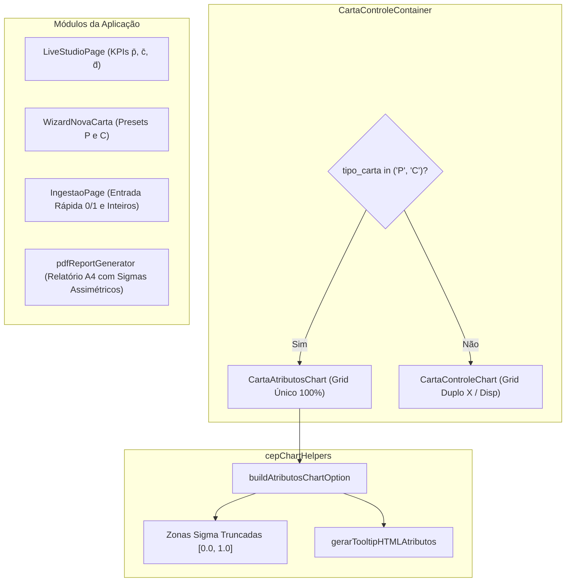

# Cartas de Controle por Atributos (Gráficos P e C) no Frontend

Este documento descreve a arquitetura, os componentes visuais, a modelagem de opções do Apache ECharts e a experiência de usuário (UX/UI) para as **Cartas de Controle por Atributos (Gráficos P e C)** no frontend da aplicação.

---

## 1. Visão Geral e Princípios de Design

Ao contrário das cartas por variáveis ($\bar{X}-R$, $\bar{X}-s$ e $I-MR$) que necessitam de dois gráficos empilhados (um para a tendência central e outro para a dispersão instantânea), as **Cartas de Atributos monitoram uma única métrica primária**:
- **Carta P**: Proporção de itens defeituosos ($p_i \in [0.0, 1.0]$).
- **Carta C**: Contagem total de defeitos/não-conformidades ($c_i \in \mathbb{N}_0$).

### Diretrizes de Interface:
1. **Grid Único de Altura Total**: O gráfico ocupa 100% da altura útil do container (`bottom: '15%'`), proporcionando ampla resolução para identificar tendências sutis e regras de Nelson.
2. **Faixas de Controle Truncadas**: As `markArea` que delimitam as Zonas Sigma $\pm 1\sigma, \pm 2\sigma, \pm 3\sigma$ respeitam estritamente o truncamento físico em $0.0$ (e $1.0$ na Carta P).
3. **Tooltips Contextuais e Enriquecidos**:
   - Para Carta P: Exibe a taxa decimal, percentual correspondente (`12.0%`) e contagem absoluta de defeituosos no subgrupo (`6 de 50 itens`).
   - Para Carta C: Exibe a contagem absoluta de defeitos (`4 defeitos`).
   - Amostras formatadas como inteiros (`[0, 1, 0, 0, 1]` ou `[4]`).
4. **Ergonomia Operacional de Ingestão**:
   - Botões binários rápidos para Carta P: Botões táteis `0 = Bom` (verde) e `1 = Ruim` (vermelho).
   - Validação estrita de números inteiros para Carta C.



---

## 2. Componentes e Implementação Técnica

### 2.1. `CartaAtributosChart.tsx`
Componente React dedicado para renderizar cartas de atributos:
- Encapsula o ciclo de vida do Apache ECharts com resize observer responsivo.
- Suporta zoom temporal/amostral dinâmico (últimos 30, 50, 100 subgrupos ou visão consolidada completa).
- Aplica temas de alta legibilidade industrial (paleta escura com contraste elevado).
- Destaca anomalias e causas especiais com marcadores pulsantes e cores de severidade.

### 2.2. Integração no `CartaControleContainer.tsx`
O container principal da aplicação despacha de forma transparente o componente gráfico correto:
```tsx
const isAtributo = tipo_carta === 'P' || tipo_carta === 'C'

return (
  <div className="w-full h-full">
    {isAtributo ? (
      <CartaAtributosChart
        tipoCarta={tipo_carta}
        subgrupos={subgrupos}
        limites={limites}
        tamanhoSubgrupo={tamanho_subgrupo}
        janelaZoom={janelaZoom}
      />
    ) : (
      <CartaControleChart
        tipoCarta={tipo_carta}
        subgrupos={subgrupos}
        limites={limites}
        tamanhoSubgrupo={tamanho_subgrupo}
        janelaZoom={janelaZoom}
      />
    )}
  </div>
)
```

### 2.3. Formatação no `LiveStudioPage.tsx`
A tela de monitoramento em tempo real adapta dinamicamente os títulos, rótulos e métricas:
- **Carta P**:
  - Título da Média: `Proporção Média p̄`
  - Título da Dispersão: `Defeituosos Médios d̄`
  - Subtítulo: `Total de defeituosos por subgrupo`
- **Carta C**:
  - Título da Média: `Total Médio c̄`
  - Título da Dispersão: `Dispersão Poisson`
  - Subtítulo: `Defeitos por lote constante`
- **Desvio Padrão Estimado**: Exibe $\hat{\sigma}_p = \sqrt{\bar{p}(1-\bar{p})/n}$ ou $\hat{\sigma}_c = \sqrt{\bar{c}}$.

### 2.4. Formulário e Wizard de Criação (`WizardNovaCarta.tsx`)
- Opção `P - Proporção de Defeituosos (Binomial)`:
  - Sugere tamanho de subgrupo representativo ($n \ge 10$).
- Opção `C - Contagem de Defeitos por Lote (Poisson)`:
  - Configura automaticamente `tamanho_subgrupo = 1` (inspeção consolidada por lote).
  - Desmarca o toggle de limites de especificação de engenharia (`temEspecificacoes = false`), permitindo submissão imediata sem campos desnecessários.

### 2.5. Ingestão de Dados Manual e em Lote (`IngestaoPage.tsx`)
- **Carta P**:
  - Adicionados botões de seleção rápida `0 = Bom` e `1 = Ruim` que preenchem o array de amostras instantaneamente com 1 clique.
  - Validação impede envio de valores fora de $[0.0, 1.0]$.
- **Carta C**:
  - Campo numérico com validação de números inteiros não-negativos ($x \ge 0$).
  - Previne submissão de valores decimais ou negativos com toast de alerta imediato.
- **Importação em Lote via JSON**:
  - O parser suporta arrays escalares como `[4, 2, 5, 3, 6]`, convertendo-os internamente para o formato compatível com a API.

### 2.6. Relatório Executivo em PDF (`pdfReportGenerator.ts`)
1. **Seção 1 (Metadados)**: Rótulos descritivos `P (Proporção Binomial)` e `C (Contagem Poisson)`.
2. **Seção 3 (Análise de Sigmas)**:
   - Para cartas P e C com truncamento em $0.0$ ou $1.0$, o relatório calcula as distâncias superior e inferior separadamente:
     $$\text{dist}_{\text{sup}} = \frac{\text{LSC} - \text{LC}}{\sigma}, \quad \text{dist}_{\text{inf}} = \frac{\text{LC} - \text{LIC}}{\sigma}$$
   - Se houver truncamento assimétrico, exibe claramente: `+3.00σ / -2.00σ`.
3. **Seção 5 (Tabela de Subgrupos Recentes)**:
   - Valores das amostras formatados como inteiros (`0`, `1` ou contagens inteiras).
   - Cabeçalhos adaptados: `Taxa (p)` / `Defeitos (d)` para Carta P; `Contagem (c)` / `Desvio (σc)` para Carta C.

---

## 3. Matriz de Rastreabilidade de Testes no Frontend

Os testes unitários e de integração de componentes foram implementados em `frontend/src/test/cartasAtributos.test.tsx` e integrados à suíte global (`npm test`).

| Teste | Escopo | Critério de Sucesso | Status |
| :--- | :--- | :--- | :--- |
| `isCartaAtributo` | Tipo e Utilitário | Retorna `true` para `'P'` e `'C'`; `false` para `'X_R'`, `'X_S'` e `'I_MR'` | **PASSOU** |
| `buildAtributosChartOption - Grid Único` | Motor ECharts | Gera `grid` de tamanho 1 ocupando 100% da altura, com apenas 1 eixo X e 1 eixo Y | **PASSOU** |
| `buildAtributosChartOption - Series P` | Nome e Series | Série principal intitulada `Proporção de Defeituosos (p)` | **PASSOU** |
| `gerarTooltipHTMLAtributos - Carta P` | Tooltip HTML | Exibe proporção decimal formatada, percentual e contagem de defeituosos no subgrupo | **PASSOU** |
| `gerarTooltipHTMLAtributos - Carta C` | Tooltip HTML | Exibe total de defeitos inteiro, regras violadas e marcador de anomalia | **PASSOU** |
| `calcularMetricasSigma - Carta P` | Cálculo Sigma | Utiliza $\sigma_p$ diretamente sem dividir novamente por $\sqrt{n}$ | **PASSOU** |
| `calcularMetricasSigma - Truncamento C` | Sigmas Assimétricos | Detecta LIC truncado em $0.0$ e calcula distância inferior fidedigna ($2.0\sigma$) | **PASSOU** |
